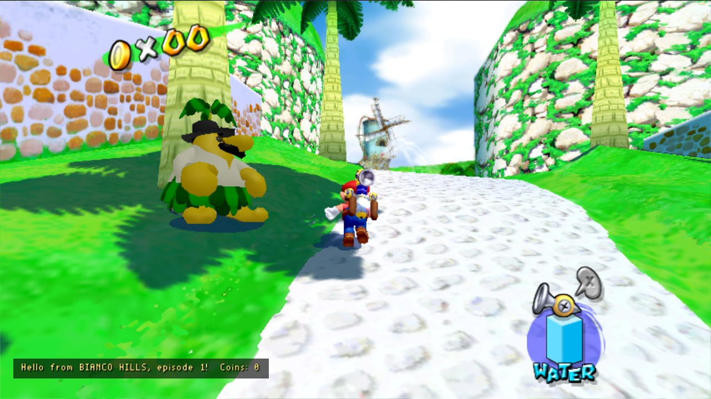
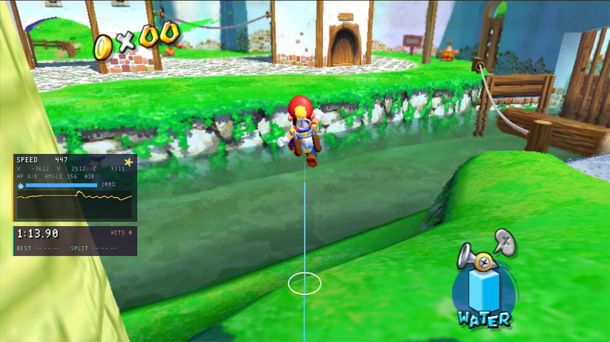
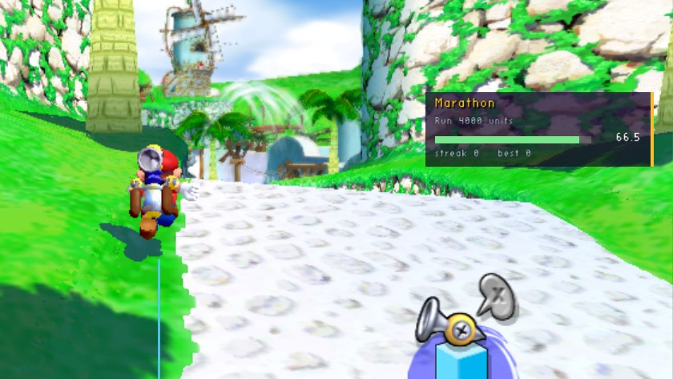

# sms-mod-templates

Templates to start a mod from, and complete example mods, for the [Super Mario Sunshine PC port](https://github.com/chasem-dev/sms-pc-port).
They are built with the [mod SDK](https://github.com/chasem-dev/sms-mod-sdk), whose [manual](https://github.com/chasem-dev/sms-mod-sdk/blob/main/docs/MODDING.md) has every event and function.


*All four examples at once. The trainer HUD's panel (top left) and its landing ring under Mario, the stage timer under it, hello at the bottom left, and a Lua challenge (top right) just completed. They share the screen because each asks the game for a place (`hud_slot`) instead of picking one.*

## Templates

Copy a template's folder out as a repository of your own. Each builds on its own, fetching the SDK at its version tag, and its GitHub workflow builds the mod for every platform and releases it as one zip when you push a tag.

| | |
| --- | --- |
| [`templates/cpp`](templates/cpp) | A native mod in C++ (with the SDK's `sms_mod.hpp`). |
| [`templates/c`](templates/c) | A native mod in C. |
| [`templates/lua`](templates/lua) | A Lua script mod: a `mod.ini` and a `main.lua`, nothing to build. Runs in the [lua mod](https://github.com/chasem-dev/sms-mod-sdk#the-lua-mod). |

All three start as the same small mod, so they can be compared side by side. It shows Mario's speed in a panel at the bottom right while a stage is played, has a key that hides it (P, O and U respectively), and has a switch in the Mods menu.


In a template, `mod/` is what ships (`mod.ini` and any images or data) and `src/` is what is built.

## Examples

### [hello](examples/hello) (C++)

The smallest useful mod. It names the stage as it loads and counts the coins taken in it, in a panel at the bottom left. H hides it, and so does its switch in the Mods menu.



### [trainer-hud](examples/trainer-hud) (C) and [stage-timer](examples/stage-timer) (C)

**trainer-hud** uses most of the API. It has a panel with Mario's speed, position, health, water and status, plus a speed graph. In the world it draws a trail behind Mario and a ring where he will land. It also has coin pop-ups, a stage banner, a field-of-view setting, invincibility (it cancels damage events) and a moon jump (hold M). F3 shows or hides the panel.

**stage-timer** is made to sit beside it. Its timer panel stacks under the trainer HUD's (`after = trainer-hud` in its `mod.ini`). It records Shine splits and best times (kept in its settings), and counts hits at `MONITOR` priority, so a hit the trainer HUD cancelled doesn't count. It also sends a custom event, `stage-timer.split`, that other mods can hear. F4 resets it.



### [lua-challenges](examples/lua-challenges) (Lua)

A challenge against the clock each time a stage loads: collect coins, take no damage, climb, run a distance or stay in the air. It shows a panel with a progress bar, marks targets in the world, plays the game's sounds when you win or lose, and keeps your best streak. R picks another challenge. It shows Lua's `sms.on`, `sms.draw`, options and `require`, and it reads the C stage-timer's `stage-timer.split` event with `string.unpack`.



## The Mods menu

F1 in the game lists every mod: whether it loaded (and why not), a switch for it, and the options it added. Here it lists all eight mods in this repository's build: the examples, the templates and the lua mod.


## Building

```sh
cmake -S . -B build -DSMS_MODS_OUT=/path/to/the/game/mods
cmake --build build
```

This builds every example and template into the game's `mods/` folder; the next start of the game loads them.
Add `-DSMS_MOD_ARCH=32` for the default Linux game (`build/linux-32`), a 32-bit program. `-DFETCHCONTENT_SOURCE_DIR_SMS_MOD_SDK=<path>` builds against a checkout of the SDK instead of its tag.
The Lua ones need the lua mod installed (from the [SDK's releases](https://github.com/chasem-dev/sms-mod-sdk/releases), or a source checkout of the port's `python3 tools/mods/get.py lua`).

Prebuilt, for every platform: the zip on this repository's [releases](https://github.com/chasem-dev/sms-mod-templates/releases).

The screenshots are from the 32-bit Linux build at 1280×720, in Bianco Hills, episode 1.

## License

[MIT](LICENSE): copy what you like into mods of your own, under any license.
