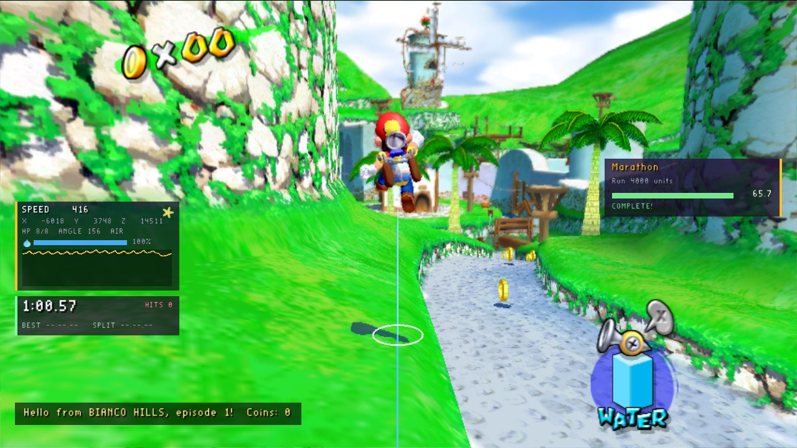
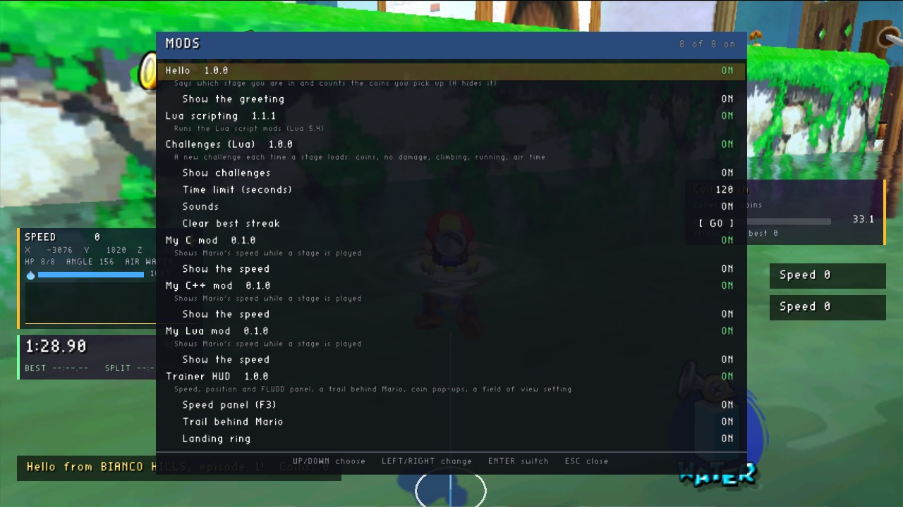

# sms-mod-templates

Templates to start a mod from, and complete example mods, for the [Super Mario Sunshine PC port](https://github.com/chasem-dev/sms-pc-port).
They are built with the [mod SDK](https://github.com/chasem-dev/sms-mod-sdk), whose [manual](https://github.com/chasem-dev/sms-mod-sdk/blob/main/docs/MODDING.md) has every event and function.



*All four examples at once: the trainer HUD's panel (top left) and its landing ring under Mario, the stage timer under it, hello at the bottom left, and a Lua challenge (top right) just completed. They share the screen because each asks the game for a place (`hud_slot`) instead of picking one.*

## Templates

Copy a template's folder out as a repository of your own. Each builds on its own, fetching the SDK at its version tag, and its GitHub workflow builds the mod for every platform and releases it as one zip when you push a tag.

| | |
| --- | --- |
| [`templates/cpp`](templates/cpp) | A native mod in C++ (with the SDK's `sms_mod.hpp`). |
| [`templates/c`](templates/c) | A native mod in C. |
| [`templates/lua`](templates/lua) | A Lua script mod: a `mod.ini` and a `main.lua`, nothing to build. Runs in the [lua mod](https://github.com/chasem-dev/sms-mod-sdk#the-lua-mod). |

All three start as the same small mod, so they can be compared side by side. It shows Mario's speed in a panel at the bottom right while a stage is played, has a key that hides it (P, O and U respectively), and has a switch in the Mods menu. Each template's README has a picture.

In a template, `mod/` is what ships (`mod.ini` and any images or data) and `src/` is what is built.

## Examples

Complete mods to read and borrow from. Each folder has a README with a picture of the mod running, and is laid out like a template: `mod/` ships, `src/` is built.

| | |
| --- | --- |
| [`examples/hello`](examples/hello) | **C++**, the smallest useful mod: names the stage as it loads and counts the coins taken in it, in a panel at the bottom left. |
| [`examples/trainer-hud`](examples/trainer-hud) | **C**, most of the API: a panel of Mario's speed, position, health and water with a speed graph, a trail and a landing ring in the world, coin pop-ups, a field-of-view setting, invincibility and a moon jump. |
| [`examples/stage-timer`](examples/stage-timer) | **C**, made to sit beside others: an in-game timer with Shine splits, best times and hits taken, whose panel stacks under the trainer HUD's, and a custom event other mods hear. |
| [`examples/lua-challenges`](examples/lua-challenges) | **Lua**: a challenge against the clock each time a stage loads, with a panel, world markers, the game's sounds and a best streak; it reads the C stage timer's event. |
| [`examples/squid-race`](examples/squid-race) | **C, a server mod**: a race round Ricco Harbor's Blooper course for everyone who joins a multiplayer game, run by the host alone; players join with the plain game. |
| [`examples/lua-red-light`](examples/lua-red-light) | **Lua, a server mod**: Red Light, Green Light for everyone in a multiplayer game; anyone the server sees moving on red goes back to the start. |

## The Mods menu

F1 in the game lists every mod: whether it loaded (and why not), a switch for it, and the options it added. Here it lists all eight mods in this repository's build: the examples, the templates and the lua mod.



## Building

```sh
cmake -S . -B build -DSMS_MODS_OUT=/path/to/the/game/mods
cmake --build build
```

This builds every example and template into the game's `mods/` folder; the next start of the game loads them.
Add `-DSMS_MOD_ARCH=32` for the default Linux game (`build/linux-32`), a 32-bit program. `-DFETCHCONTENT_SOURCE_DIR_SMS_MOD_SDK=<path>` builds against a checkout of the SDK instead of its tag.
The Lua ones need the lua mod installed (from the [SDK's releases](https://github.com/chasem-dev/sms-mod-sdk/releases), or a source checkout of the port's `python3 tools/mods/get.py lua`).

Prebuilt, for every platform: the zip on this repository's [releases](https://github.com/chasem-dev/sms-mod-templates/releases).

The screenshots are from the 32-bit Linux build at 1280×720, in Bianco Hills, episode 1.

## License

[MIT](LICENSE): copy what you like into mods of your own, under any license.
