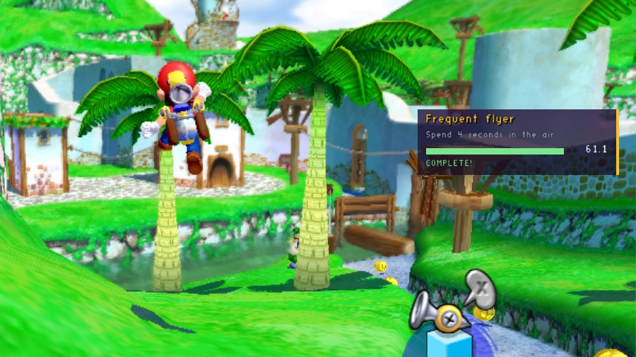

# Challenges (Lua)

A Lua script mod. About two seconds after each stage loads, it sets a challenge against the clock:

- **Coin rush:** collect 6 coins
- **Untouchable:** take no damage until time runs out
- **Skyward:** climb 600 units above where you started (a ring marks the height)
- **Marathon:** run 4000 units
- **Frequent flyer:** spend 4 seconds in the air

A panel at the top right shows the challenge, a progress bar and the time left. You hear the game's sounds when you win or lose, and your best streak is kept.



*The Challenges mod on its own in Bianco Hills: a Frequent flyer challenge (4 seconds in the air) just completed, mid-jump.*

It needs the **lua** mod, which runs Lua script mods and isn't part of the game: get it from the [SDK's releases](https://github.com/chasem-dev/sms-mod-sdk/releases), or in a source checkout of the port, `python3 tools/mods/get.py lua`.

## Controls and settings

| | |
| --- | --- |
| **R** | picks another challenge (`key.reroll`) |
| Mods menu (F1) | **Show challenges**; **Time limit** (15 to 120 seconds); **Sounds**; **Clear best streak** |

## What it shows

Nothing to build: [`mod/`](mod) is the whole mod, the same on every computer.

- **[`mod/main.lua`](mod/main.lua)** has the events (`sms.on("stage_loaded")`, `"tick"`, `"item_collected"`, `"key"`, `"draw"`), the drawing (`sms.draw.hud_slot`, `gradient`, `rect`, `text`, `world_ring`, `world_text`), options with `sms.option{...}`, and its key with `sms.bind_key`.
- **[`mod/challenges.lua`](mod/challenges.lua)** is a module of its own, loaded with `require("challenges")`. Adding a challenge is adding a table there.
- **Watching other mods' changes:** it hears `player_damage` at `sms.MONITOR` and counts only hits nobody cancelled.
- **Lua and C together:** it reads the C [stage-timer](../stage-timer)'s `stage-timer.split` event with `string.unpack("<fi4", ev.data)`.

To start a Lua mod of your own, copy [`templates/lua`](../../templates/lua). Run the game with `SMS_NATIVE_MODS_HOT=1` and each save of a script loads it again.

## Build and install

From the repository's root, which builds every example and template:

```sh
cmake -S . -B build -DSMS_MODS_OUT=/path/to/the/game/mods   # -DSMS_MOD_ARCH=32 for the 32-bit Linux game
cmake --build build
```

It then sits in `mods/lua-challenges/`, and the next start of the game loads it. A prebuilt copy for every platform is in the zip on the repository's [releases](https://github.com/chasem-dev/sms-mod-templates/releases).

The Lua API: [MODDING.md, "Lua scripts"](https://github.com/chasem-dev/sms-mod-sdk/blob/main/docs/MODDING.md#lua-scripts).
