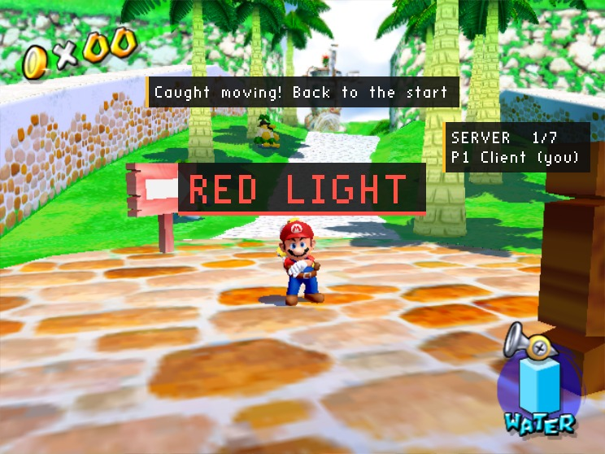
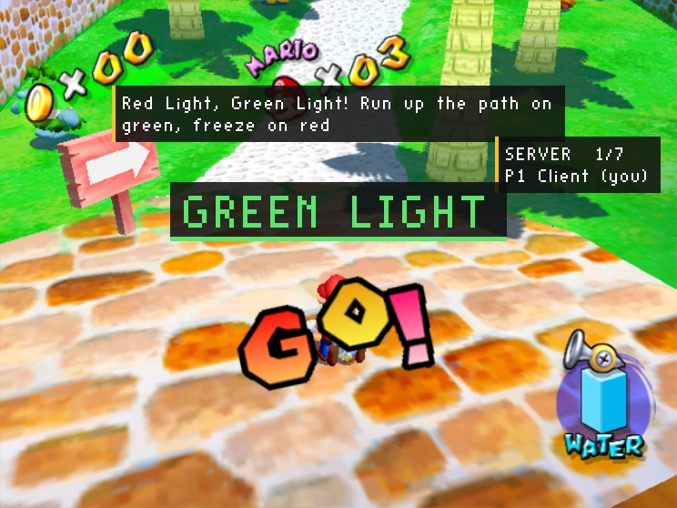

# Red Light, Green Light (Lua, server mod)

The playground game, for everyone who joins a multiplayer game: on a green light everyone runs up Bianco Hills' path for the goal; on a red light everyone must freeze, and anyone the server sees moving goes back to where they started. The first to the goal wins, everyone else watches them for a moment, and a new round starts.

It is a **server mod** in Lua: it runs on the host only (`side = server`, with the [lua mod](https://github.com/chasem-dev/sms-mod-sdk#the-lua-mod) installed there), and **players join with the plain game**. The whole mod is [`mod/main.lua`](mod/main.lua), about 150 lines.



*A player's plain game: they kept running through a red light, so the server sent them back to the start.*



## How it is made

- **The lights** are banners and sounds sent to everyone: `sms.net.send("all", { type = "banner", color = GREEN, text = "GREEN LIGHT" })`.
- **Who moved** is the server's call: `sms.net.player(slot).position` is where each player's game last said they were. A short grace after the light turns red covers reaction and the network; after that, a player who drifts more than a few units is caught.
- **Caught:** `{ type = "warp", position = start }` puts them back at their start (wherever the server first saw them in play), with a notice and a sound. Their next update takes a moment to show the warp, so a player just caught is left alone for a second and a half.
- **The goal** is a point up the path; the first player within reach of it wins: a banner in their colour, the race fanfare, and `{ type = "watch", slot = winner }` for everyone else.
- **Rounds:** `sms.net.load_stage(2, 0)` loads the stage afresh for everyone; `net_session` starts the next round, with a sticky `stay` so nobody wanders off through a pipe.

## Running it

The server's mods folder needs this mod and the lua mod:

```sh
SMS_HEADLESS=1 SMS_AUDIO=0 SMS_TEXTURE_PACKS=0 \
SMS_MULTIPLAYER=host SMS_MULTIPLAYER_DEDICATED=1 \
SMS_NATIVE_MODS_DIR=/path/to/server-mods \
./sms GMSE01.iso
```

**Players a round needs** (`min_players`, 1) is in the host's Mods menu, or the mod's `settings.ini`.

The manual's [Server mods](https://github.com/chasem-dev/sms-mod-sdk/blob/main/docs/MODDING.md#server-mods) section has every command and field.
