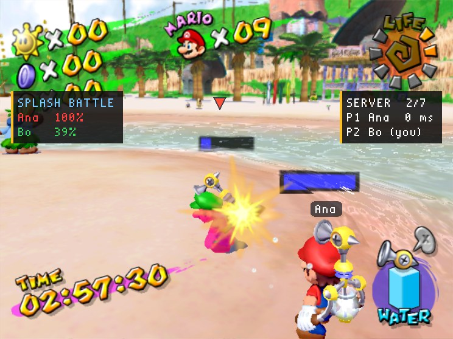
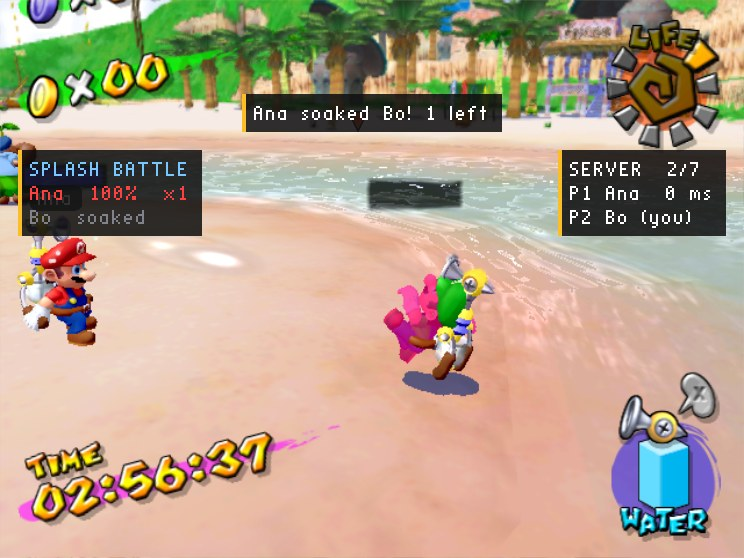
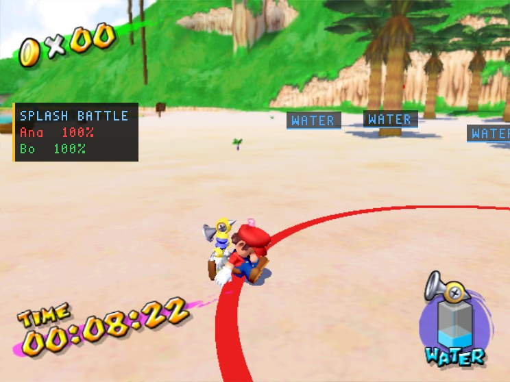
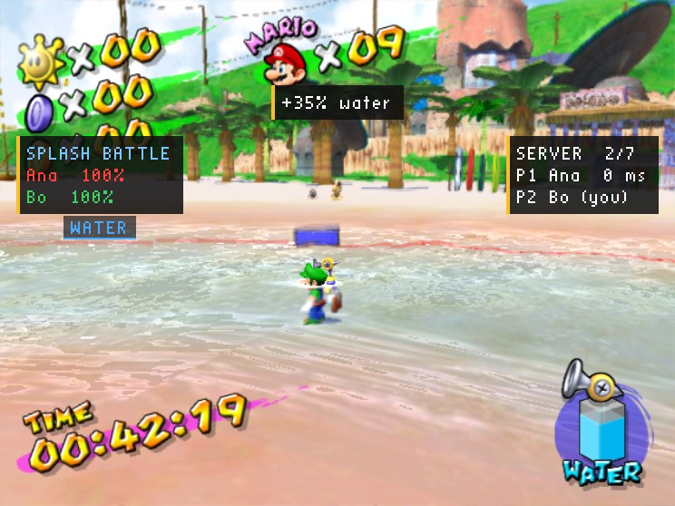
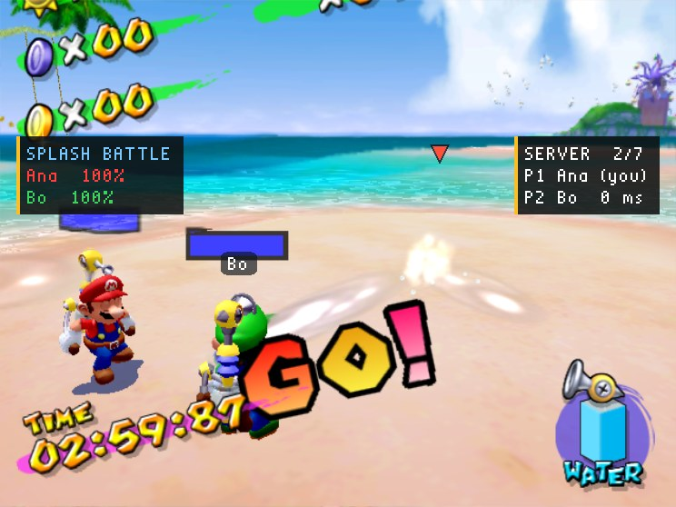

# Splash Battle (C, server mod)

A game mode for the port's multiplayer: a water fight. Everyone who joins is in the arena (Gelato Beach) with FLUDD, and FLUDD's water hits the other players. Whoever is hit reacts as Shadow Mario does when Mario sprays him in his chases: his splash and hit sound, his flush, and his water meter over their head. Empty it and they go down as he does, out of the round. The last one standing wins.

It is a **server mod** (`side = server` in its `mod.ini`): it runs on the host of the game, a dedicated server as a rule, and **players join with the plain game**, nothing installed. The mod keeps the meters and decides who is out; each player's game shows it all with its own models, sounds and HUD.



*Bo's game in the middle of a round: Ana's water hits him (Shadow Mario's splash on his back), his model flushed as Shadow Mario's is, his water meter over his head down to 39%. The board at the left keeps the standings; the HUD's health shows his meter too.*



*His meter empty: thrown back onto the sand, as Shadow Mario falls when his is. Two seconds later everyone watches the winner.*



*The arena's edge, a red line on the sand: nobody gets past it, and over the round it closes in, pushing everyone before it. The arena is inland, on the beach's widest stretch of sand, clear of the sea.*



*Water is scarce: FLUDD doesn't fill up from the sea, so players race for the pickups (the WATER markers), each coming back somewhere else after its cooldown.*



*"GO!": everyone was put on a ring round the arena's middle, facing it, and held until now. Each player's meter shows over their head.*

## A round

| | What players see | What the server does |
| --- | --- | --- |
| **Lobby** | "waiting for players (1 of 2 here)", free to play inside the red edge; the HUD shows only health and FLUDD's water (no Shines, coins or lives) | counts the players in the arena; the stage's enemies are hidden and its Shines gone, and nobody can leave the arena: its edge (`SMS_CMD_BOUNDS`) is drawn on the ground round its middle, inland, and every player arriving is put inside it (`net->set_respawn`), not out where the stage starts them |
| **Countdown** | "SPLASH BATTLE IN 8", the clock counting down | three seconds before the start: everyone onto a ring round the arena's middle, facing it, held; a third of a tank each, FLUDD using water three times as fast, the spray nozzle |
| **Battle** | "Ready... Go!", Shadow Mario's chase music, the clock counting down from the time limit; a board of everyone's meter | water hits the other players (`SMS_RULE_WATER_HITS`); each drop that hits takes one off the meter; players collide; FLUDD fills up only from the pickups (`SMS_RULE_NO_REFILL`) |
| **Water** | WATER markers round the arena; "+35% water" for whoever reaches one | five pickups at random spots on dry ground inside the edge; the first player there gets a share of a tank (`SMS_PLAYER_ADD_WATER`); each comes back somewhere else 40 seconds later |
| **The arena closes** | "The arena is closing in!"; the red edge moving in | after a fifth of the time limit the edge glides in to 600 units, pushing everyone before it, by seven-eighths of it |
| **Out** | "Ana soaked Bo! 1 left"; the one soaked is thrown back, then watches whoever soaked them | a meter at 0 is out; so is a player who falls out of the arena (a lost life) or leaves |
| **Winner** | "Ana WINS!" in their colour, the race fanfare; everyone watching the winner | the last one standing wins; at the time limit, the fullest meter (a tie is a draw) |
| **Restart** | the arena afresh | loads the arena again for everyone: a new session, the lobby |

A player who joins during a battle watches it and plays the next round.

## Settings

On the host: its Mods menu (F1), or `settings.ini` in the mod's data folder.

| | |
| --- | --- |
| **Players a round needs** (`min_players`) | 2 |
| **Countdown** (`countdown`) | 15 seconds |
| **Water meter** (`meter`) | 300 drops: about three seconds of a spray held on someone close by |
| **Time limit** (`time_limit`) | 180 seconds |
| **Winner shown** (`winner_seconds`) | 10 seconds |
| **Arena's middle** (`middle_x`, `middle_z`) | 1800, 2800: Gelato Beach's widest stretch of sand, inland (3800 units of beach round it, 800 from the sea). 0, 0: where the stage starts its players |
| **Arena's edge** (`zone_radius`) | 3600 units from the middle |
| **The arena closes in** (`zone`), **to** (`zone_end`) | on, to 600 units |
| **FLUDD fills up by itself** (`refill`) | off: only from the pickups |
| **Water at the start** (`start_water`), **water use** (`water_use`) | 30% of a tank; 300% of FLUDD's own rate (a full tank sprays for about half a minute) |
| **Water pickups** (`pickups`), **water a pickup gives** (`pickup_water`), **back after** (`pickup_cooldown`) | 5; 35% of a tank; 40 seconds |
| **Players collide** (`collision`) | on (off: the host's own Player Collision setting) |
| **Arena** (`area`, `episode`) | 4, 0: Gelato Beach. The middle is where the stage puts its players |

## Running a server

Build the mod (below), put it in a folder of mods for the server, and start the game as a dedicated server:

```sh
SMS_HEADLESS=1 SMS_AUDIO=0 SMS_TEXTURE_PACKS=0 \
SMS_MULTIPLAYER=host SMS_MULTIPLAYER_DEDICATED=1 \
SMS_NATIVE_MODS_DIR=/path/to/server-mods \
./sms GMSE01.iso
```

or put it in [sms-server](https://github.com/chasem-dev/sms-server)'s `mods/`. It goes straight from the title to the arena; players join it as any game. A player's own game can host it too (Host Game with the mod installed): it plays along.

Players' games need mod API 1.5 beta 7 or later (`client_api = 1.5`; an older 1.5 beta has no arena's edge, water hits or water rules).

## Building

```sh
cmake -S . -B build -DSMS_MODS_OUT=/path/to/server-mods   # -DSMS_MOD_ARCH=32 for the 32-bit Linux game
cmake --build build
```

## How it is made

The whole mod is [`src/splash_battle.c`](src/splash_battle.c): plain C against the SDK's `sms_mod.h`, API 1.5 beta 7 (water fights and arenas, docs/MODDING.md).

- **Water hits are the players' games' word:** with `SMS_RULE_WATER_HITS` each game stops its own player's drops at the other players and tells the host; the mod hears `SMS_EV_NET_PLAYER_SPLASHED` (who, by whom, how many drops) and takes them off that player's meter.
- **The reaction is every game's:** `SMS_CMD_SPLASH` to everyone, with the meter left, shows Shadow Mario's splash, sound, flush and meter on that player in every game; `SMS_SPLASH_DOWN` when it is empty throws them back. `SMS_PLAYER_HEALTH` puts the meter on their HUD's health as well.
- **Collision:** `net->set_collision(1)` for the arena's sessions, so nobody hides inside anyone and a stomp lands.
- **The arena, in every game:** `BOUNDS` keeps everyone within its edge and draws it on the ground, and one `BOUNDS` with `f2[0]` seconds closes it; `ACTORS` hides the stage's enemies and kills its Shines, `STAY` keeps everyone there, `RULES` keeps damage off, `HUD` leaves only the health (the water meter) and FLUDD's water on the HUD; all **sticky**, so a player arriving later gets them too.
- **Water as ammunition:** `SMS_RULE_NO_REFILL`, `SMS_PLAYER_WATER` at the start, `SMS_PLAYER_WATER_USE`, and the pickups: `MARKER`s over spots on dry ground (`game->ground` on the server's own copy of the stage), judged from where the server hears each player is, `SMS_PLAYER_ADD_WATER` for whoever reaches one.
- **The start, lined up across the players:** at three seconds to go it sends `WARP` and `HOLD` now, and `HOLD` off, `RULES` with water hits, `TIMER`, the start's sound and the music with a `delay_ms` of the time left; `READY_GO` gets "Go!" there too.
- **Events:** `SMS_EV_NET_SESSION` (the arena loaded: set it up, the lobby), `SMS_EV_NET_PLAYER_SPLASHED` (a hit), `SMS_EV_NET_PLAYER_ARRIVED` (someone in the arena: mid-battle, they watch), `SMS_EV_NET_PLAYER_LEFT`, `SMS_EV_NET_PLAYER_JOINED` (a welcome), and `SMS_EV_FRAME` for the rest.
