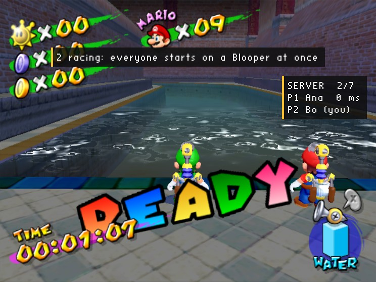
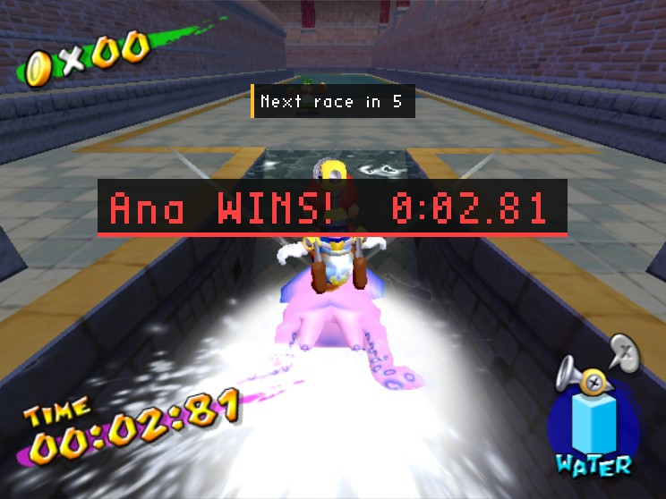

# Squid Race (C, server mod)

A game mode for the port's multiplayer: everyone who joins races Ricco Harbor's Blooper course (the second episode's secret course), round after round.

It is a **server mod** (`side = server` in its `mod.ini`): it runs on the host of the game, a dedicated server as a rule, and **players join with the plain game**, nothing installed. The mod decides when and where (the countdown, the start line, who is where round the course, who won), and each player's game carries that out with its own models, sounds and HUD.



*Bo's game, a plain game with no mods, lined up beside Ana for the start. The banner, the clock, the line-up and "Ready... Go!" are all the server's word.*



*Ana won: everyone else's camera rides along with her for a while, the clock stopped at her time, then the course loads afresh for the next race.*

## A round

| | What players see | What the server does |
| --- | --- | --- |
| **Lobby** | "waiting for players (1 of 2 here)" | counts the players who have arrived in the course |
| **Countdown** | "RACE STARTS IN 8", the HUD's clock counting down | three seconds before the start: each player to their place on the start line, held still; sends the start itself, delayed to the same moment in every game |
| **Start** | "Ready... Go!", everyone on a Blooper at once, the clock running, the race's music | (carried out by each game at the moment given) |
| **Racing** | "Halfway!", "Home straight!" | follows each player round the course with the course's own trigger cubes (A, B, C and A again, as its time trial did), from where their updates say they are |
| **Winner** | "Ana WINS!  0:02.81" in their colour, the race fanfare; everyone's camera riding with the winner | the first one round wins; a race nobody finishes ends at the time limit ("TIME'S UP!") |
| **Restart** | the course afresh | loads the course again for everyone: a new session, the lobby |

Falling in costs a life (the server keeps the lives up, so a race has no game over): the player is back at the start, on a Blooper, the clock still running.

## Settings

On the host: its Mods menu (F1), or `settings.ini` in the mod's data folder.

| | |
| --- | --- |
| **Players a race needs** (`min_players`) | 2 |
| **Countdown** (`countdown`) | 20 seconds |
| **Winner shown** (`winner_seconds`) | 10 seconds |
| **Time limit** (`time_limit`) | 180 seconds |

## Running a server

Put the built mod in a folder of mods for the server, and start the game as a dedicated server:

```sh
SMS_HEADLESS=1 SMS_AUDIO=0 SMS_TEXTURE_PACKS=0 \
SMS_MULTIPLAYER=host SMS_MULTIPLAYER_DEDICATED=1 \
SMS_NATIVE_MODS_DIR=/path/to/server-mods \
./sms GMSE01.iso
```

It goes straight from the title to the course and opens its port (UDP 24002, or `SMS_MULTIPLAYER_PORT`); players join it as any game (the launcher's Join, or `SMS_MULTIPLAYER=join`). A player's own game can host the race too (Host Game with the mod installed): it plays along.

## How it is made

The whole mod is [`src/squid_race.c`](src/squid_race.c): plain C against the SDK's `sms_mod.h`, API 1.2 (`api->net`).

- **What the course needs, in every game:** `STOP_SCRIPT` stops the course's own time trial, `ACTORS` hides its Bloopers until the start and removes its Shines, `STAY` keeps players from wandering off. All **sticky**, so a player arriving later (or back after falling in) gets them too.
- **The start, lined up across the players:** at three seconds to go it sends `WARP` and `HOLD` now, and `MOUNT`, `HOLD` off, `TIMER` up, the start's sound and the music with a `delay_ms` of the time left, so every game does them at once; `READY_GO` gets "Go!" there as well.
- **The race is judged on the server:** `net->player()` says where each player is, and `game->in_cube()` asks the server's own copy of the course whether that is in one of its cubes, as the course's script asked of Mario.
- **Events:** `SMS_EV_NET_SESSION` (the course loaded: set it up, the lobby), `SMS_EV_NET_PLAYER_ARRIVED` (someone in the course: the clock as it stands, or a Blooper at the start mid-race), `SMS_EV_NET_PLAYER_JOINED` (a welcome), and `SMS_EV_FRAME` for the rest.

The manual's [Server mods](https://github.com/chasem-dev/sms-mod-sdk/blob/main/docs/MODDING.md#server-mods) section explains how server mods work, with every command.
