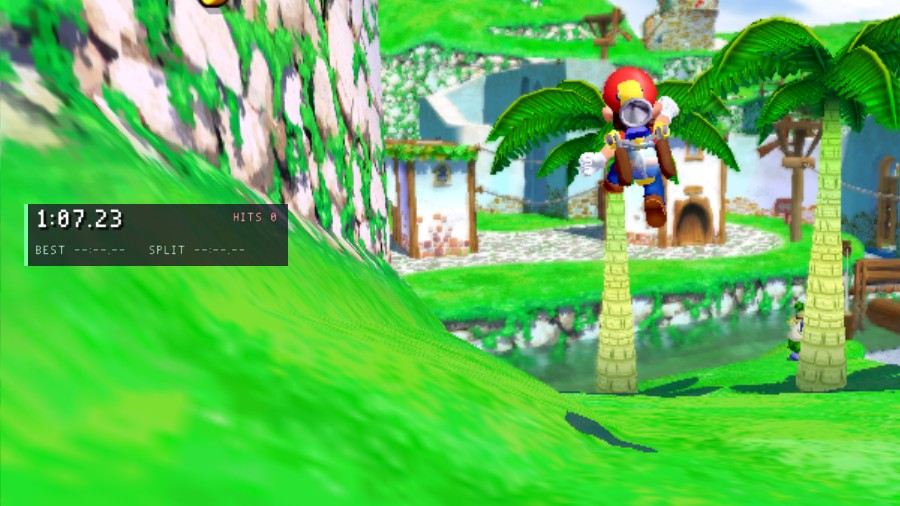

# Stage Timer (C)

A speedrun-style timer for each stage. It counts in-game time (it stops while the game is paused), splits at each Shine, keeps the best time of each stage and episode, and counts the hits Mario takes.



*The Stage Timer on its own in Bianco Hills. Next to the [Trainer HUD](../trainer-hud), its panel stacks under the trainer's.*

## Controls and settings

| | |
| --- | --- |
| **F4** | starts the timer again (`key.reset`) |
| Mods menu (F1) | **Show the timer**, **Show best and split**, **Clear best times** |

## What it shows

It is written to sit beside other mods:

- **Sharing the screen:** its panel takes a HUD slot at the same anchor as the Trainer HUD's, so the two stack. `after = trainer-hud` in its `mod.ini` loads it second, so it goes underneath.
- **Respecting other mods' changes:** it watches `SMS_EV_PLAYER_DAMAGE` at `SMS_PRIORITY_MONITOR`, after every other mod, and leaves out hits another mod cancelled (the Trainer HUD's invincibility).
- **Talking to other mods:** at each Shine it sends a custom event, `stage-timer.split`, carrying `{float seconds; int shine}`. The Trainer HUD shows it as a pop-up, and [lua-challenges](../lua-challenges) reads it from Lua.
- **Game time, not frames:** it counts `SMS_EV_TICK`, so the time is right at 30, 60 or 120 fps and stops during the pause menu.
- **Settings:** best times are kept in its settings file (`best.<area>.<episode>`), which survives restarts.

The whole mod is [`src/stage_timer.c`](src/stage_timer.c).

## Build and install

From the repository's root, which builds every example and template:

```sh
cmake -S . -B build -DSMS_MODS_OUT=/path/to/the/game/mods   # -DSMS_MOD_ARCH=32 for the 32-bit Linux game
cmake --build build
```

It then sits in `mods/stage-timer/`, and the next start of the game loads it. A prebuilt copy for every platform is in the zip on the repository's [releases](https://github.com/chasem-dev/sms-mod-templates/releases).

Every event and function: [MODDING.md](https://github.com/chasem-dev/sms-mod-sdk/blob/main/docs/MODDING.md).
