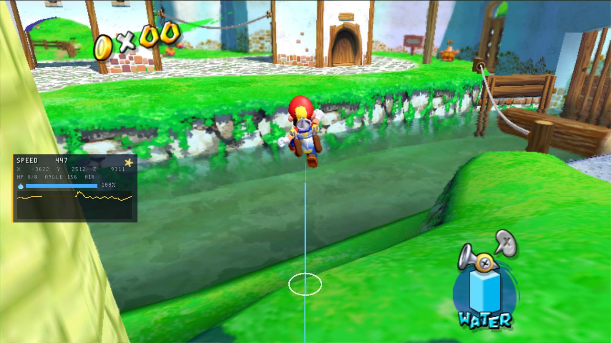

# Trainer HUD (C)

A practice overlay that uses most of the mod API. A panel shows Mario's speed, position, health, water and state, with a graph of his speed. In the world, it draws a trail behind him and a ring where he will land.



*The Trainer HUD on its own in Bianco Hills while Mario jumps. The ring on the ground is where he will land. His trail runs back toward the camera as the light blue line.*

It also:

- shows "+1" pop-ups where coins were taken
- shows the stage's name as it loads, and a banner for each new Shine
- has a field-of-view setting, invincibility and a moon jump

## Controls and settings

| | |
| --- | --- |
| **F3** | shows and hides the panel (`key.toggle_panel`) |
| **M** (held) | moon jump, when switched on (`key.moon_jump`) |
| Mods menu (F1) | **Speed panel**, **Trail behind Mario**, **Landing ring**, **Coin pop-ups**; **Field of view** (the game's, or 40 to 80 degrees); **Moon jump**, **Invincible** (both off at first) |

Moon jump and invincibility change how the game plays, so its `mod.ini` says `gameplay = 1` and the game lists it among the mods that do.

## What it shows

- **Drawing:** a panel and graph in a HUD slot, `world_line` and `world_ring` in the world, text, and two images: one made from pixels (`image_create`) and one read from [`mod/logo.png`](mod/logo.png) (`image_load`).
- **Events:** `SMS_EV_TICK` (the trail, the graph, the moon jump), `SMS_EV_ITEM_COLLECTED` (pop-ups), `SMS_EV_STAGE_LOADED` and `SMS_EV_SHINE_COLLECTED` (banners), `SMS_EV_KEY`.
- **Changing the game:** `SMS_EV_CAMERA` sets the field of view; `SMS_EV_PLAYER_DAMAGE` is cancelled for invincibility; `player->set_velocity` makes the moon jump.
- **Other mods:** it listens for [stage-timer](../stage-timer)'s custom event, `stage-timer.split`, and shows each split as a pop-up when that mod is there, and nothing when it is not.

The whole mod is [`src/trainer_hud.c`](src/trainer_hud.c). [`mod/`](mod) is what ships: `mod.ini` and the logo.

## Build and install

From the repository's root, which builds every example and template:

```sh
cmake -S . -B build -DSMS_MODS_OUT=/path/to/the/game/mods   # -DSMS_MOD_ARCH=32 for the 32-bit Linux game
cmake --build build
```

It then sits in `mods/trainer-hud/`, and the next start of the game loads it. A prebuilt copy for every platform is in the zip on the repository's [releases](https://github.com/chasem-dev/sms-mod-templates/releases).

Every event and function: [MODDING.md](https://github.com/chasem-dev/sms-mod-sdk/blob/main/docs/MODDING.md).
