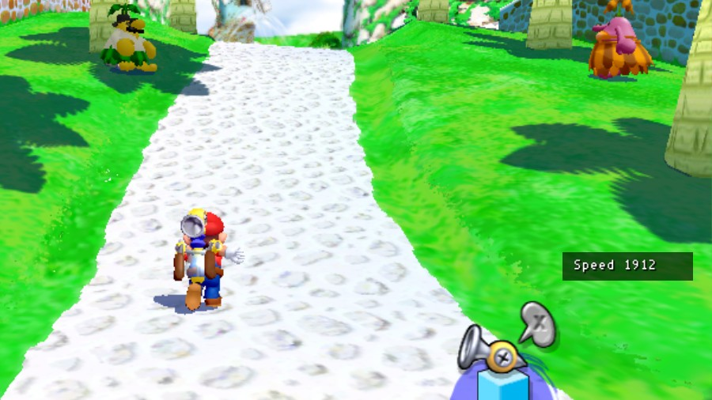

# My C mod

A template for a native mod for the [Super Mario Sunshine PC port](https://github.com/chasem-dev/sms-pc-port), in C.
As it is, it shows Mario's speed in a panel at the bottom right while a stage is played; O hides it, and so does its switch in the Mods menu (F1).



*The template as it is, running alone in Bianco Hills. The panel takes its place with `hud_slot`, so other mods' panels there stack with it instead of overlapping. The speed is Mario's horizontal velocity in units a second.*

## Make it yours

1. Copy this folder out as a repository of your own (from [sms-mod-templates](https://github.com/chasem-dev/sms-mod-templates): `templates/c`).
2. In [`mod/mod.ini`](mod/mod.ini), give it your own `id`, `name`, `author` and `description`. `library` names the built file (`<library>.dll`, `.so` or `.dylib`); the build reads it from there.
3. Write the mod in [`src/my_mod.c`](src/my_mod.c). The manual, with every event and function: [MODDING.md](https://github.com/chasem-dev/sms-mod-sdk/blob/main/docs/MODDING.md). The [examples](https://github.com/chasem-dev/sms-mod-templates/tree/main/examples) are complete mods to borrow from.

## Build

```sh
cmake -S . -B build -DSMS_MODS_OUT=/path/to/the/game/mods
cmake --build build
```

CMake fetches the [SDK](https://github.com/chasem-dev/sms-mod-sdk) at the version in `CMakeLists.txt` (`GIT_TAG`) and puts the mod in `<SMS_MODS_OUT>/my-c-mod/`, as the game loads it; the next start of the game loads it.
Add `-DSMS_MOD_ARCH=32` for the default Linux game (`build/linux-32`), which is a 32-bit program: a mod must have the game's pointer size. Windows (Visual Studio or MSYS2) and macOS need nothing more.
With `SMS_NATIVE_MODS_HOT=1` the running game loads the mod again each time you build it.

## Release

Push a tag (`git tag v1.0.0 && git push --tags`): the workflow in [`.github/workflows/build.yml`](.github/workflows/build.yml) builds the mod for Windows (32- and 64-bit), Linux (32- and 64-bit x86, arm64) and macOS (Apple Silicon and Intel; Linux on Ubuntu 22.04, so the libraries load on glibc 2.35 and newer), and releases one zip holding `my-c-mod/` with a library for each. Players unzip it into the game's `mods/` folder.
Every push and pull request builds all of them too.
